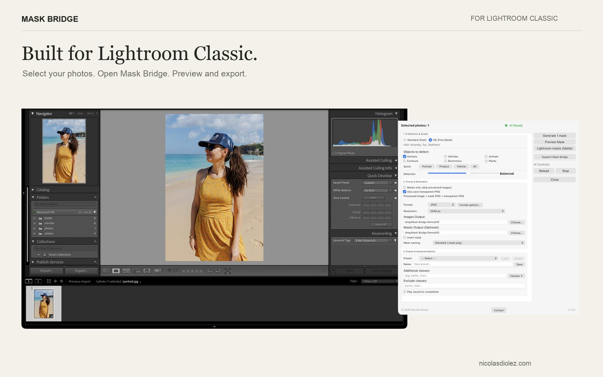
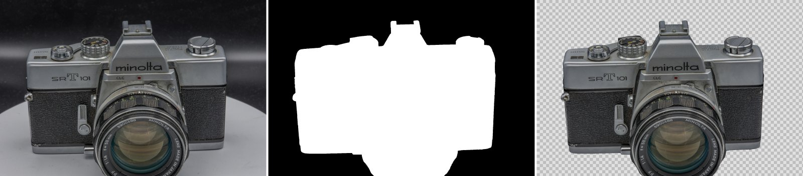

# Mask Bridge

**Masks and transparent cutouts from Lightroom Classic, for whole selections, computed on your own computer.**

Mask Bridge is a free, open-source plugin for Adobe Lightroom Classic. For every selected photo it writes the image, a grayscale mask and an optional transparent PNG with matching filenames, ready for compositing, photogrammetry or Gaussian splatting.



## What it does

Mask Bridge has two routes.

**Generate (AI detection).** Choose what to cut out among the 80 COCO classes (people, vehicles, animals, furniture…) and Mask Bridge detects and segments them with RF-DETR. An optional HD mode refines hair and fur with BiRefNet; it is slower and meant for single photos or small selections.

**Matte (Lightroom masks).** Mask Bridge exports masks computed by Lightroom itself:

- a new AI mask (Subject, Sky, Background, People, Objects, Landscape) created for each photo, then exported;
- an existing mask, or all masks of a photo, combined or one file per mask.

On Lightroom Classic 15.3 and later, Matte runs over a whole selection from the Library.

**Output.** JPEG, TIFF (8/16-bit) or PNG at original size or a chosen width, a grayscale mask (white = selected), and, if requested, a 32-bit RGBA PNG whose alpha matches the mask.



**For photogrammetry and Gaussian splatting.** In a test on 144 photos of a camera on a turntable (same COLMAP poses, 10,000 steps in Brush), the splat trained on Mask Bridge cutouts left out the turntable and the backdrop that clouded the splat trained on the original photos. COLMAP aligned every view with or without masks.

## Limits

- Matte exports **binary silhouettes estimated from Lightroom renders**. Gradients, soft brush strokes and mask opacity are not kept.
- Masks are written as files outside Lightroom. They are not imported back as editable Lightroom masks.
- Results depend on the image. Check a few representative photos before a large batch.
- Lightroom may compute its AI masks at a lower resolution than the full image, so their edges can look softer than a Photoshop selection.

## Requirements

- Adobe Lightroom Classic 14 or later (batch Matte from the Library needs 15.3 or later)
- macOS 14 or later on Apple Silicon, or Windows 10/11 64-bit
- About 420 MB of free disk space

Intel Macs and the cloud-based Lightroom are not supported.

## Install

1. Get the archive for your system at [nicolasdiolez.com/maskbridge](https://nicolasdiolez.com/maskbridge): pay what you want, from €0. The macOS engine is signed and notarized by Apple. Each version's SHA-256 checksums are listed in its [release notes](https://github.com/nicolasdiolez/mask-bridge/releases).
   You can also build Mask Bridge yourself from this repository (see [BUILDING.md](BUILDING.md)).
2. Unzip it and move `MaskBridge.lrplugin` to a folder you keep.
3. In Lightroom Classic: **File › Plug-in Manager › Add**, then choose `MaskBridge.lrplugin`.
4. Open **Library › Plug-in Extras › Mask Bridge Dashboard**.

Details, update steps and troubleshooting: [INSTALL.md](MaskBridge.lrplugin/docs/INSTALL.md), [QUICKSTART.md](MaskBridge.lrplugin/docs/QUICKSTART.md), [FAQ.md](MaskBridge.lrplugin/docs/FAQ.md).

## Privacy

Image processing runs locally. Mask Bridge needs no account, sends no telemetry and makes no network connection while you use it.

## How it works

The plugin is written in Lua and runs inside Lightroom Classic. It renders the selected photos through Lightroom's export sessions and passes them to a local engine: a Python program built with PyInstaller that runs the ONNX models with ONNX Runtime (Core ML on macOS, CPU on Windows). The engine listens only on the loopback interface, behind a per-session token.

```
MaskBridge.lrplugin/
  *.lua                  plugin, Dashboard, export provider, Matte
  TranslatedStrings_*    9 interface languages
  backend/               engine sources, tests, models/ (downloaded, not in Git)
tools/release/           build, packaging and verification scripts
tools/fetch_models.py    downloads the two ONNX models and checks their SHA-256
```

## Building from source

See [BUILDING.md](BUILDING.md). In short: Python 3.13, the hash-locked dependencies, `python tools/fetch_models.py`, the tests, then the platform build script.

## Contributing

Bug reports with your system, Lightroom version, steps and the Mask Bridge log are welcome in [Issues](https://github.com/nicolasdiolez/mask-bridge/issues). Before a pull request, read [CONTRIBUTING.md](CONTRIBUTING.md): it lists the rules that protect original files and the Lightroom catalog.

## Support the project

Mask Bridge is free and open source. Ready-to-install builds are pay what you want, from €0, at [nicolasdiolez.com/maskbridge](https://nicolasdiolez.com/maskbridge): if the plugin saves you time, choosing a price there supports its development. Each new version is added to your Lemon Squeezy order (My Orders). If you bought an earlier, paid version, download 1.2.0 from the same page, from €0.

## License

Mask Bridge is released under the [MIT license](LICENSE). Release builds include third-party models and libraries under their own licenses: RF-DETR (Apache 2.0), BiRefNet (MIT), ONNX Runtime (MIT), OpenCV (Apache 2.0), NumPy (BSD) and others listed in [THIRD_PARTY_LICENSES.md](MaskBridge.lrplugin/THIRD_PARTY_LICENSES.md).

Adobe, Lightroom and Photoshop are trademarks of Adobe Inc. Mask Bridge is an independent project, not affiliated with or endorsed by Adobe.

Made by [Nicolas Diolez](https://nicolasdiolez.com), photographer and 3D scanner, France.
